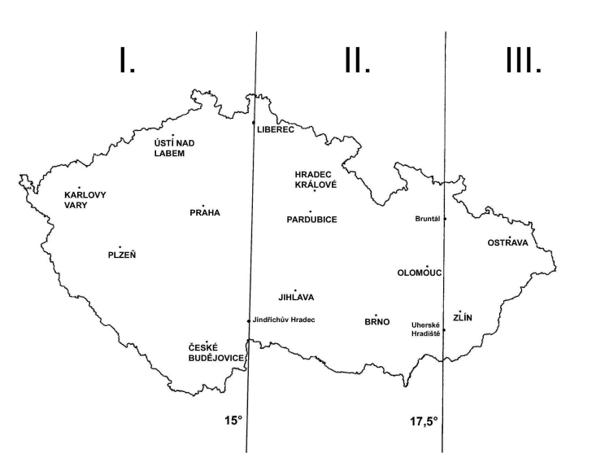

# Osvětlení pro kolejiště

Tato aplikace bude mít dvě části

## Backend
- serverová část - poběží neustále na počítači
- napsaná v Pythonu
- po spuštení si načte stromovou strukturu

### Předpis pro osvětlení
- v dokumentu specifikované na straně 31
- jsou 3 oblasti
 (strana 30)
- pro zjištění letního / zimního času je třeba
```bash
pip install tzdata
```
