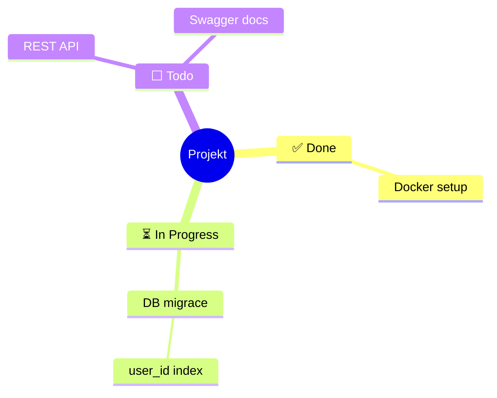

# 🚀 Plán projektu

- [ ] **1. Backend & API**
  - [x] Návrh databázového schématu
  - [ ] Implementace endpointů
    - [x] `POST /auth/login`
    - [ ] `GET /users/me`
  - [ ] Nastavení CORS a zabezpečení
- [ ] **2. Frontend rozhraní**
  - [ ] Komponenta pro tabulku dat
  - [ ] Tmavý režim (Dark mode)

### 📌 Sprint 1

> #### 🔐 Autentizace
> - [x] ~~Registrace uživatele~~ `done`
> - [ ] Validace hesla `in progress`
>   - [x] Minimálně 8 znaků
>   - [ ] Speciální znak
> - [ ] Reset zapomenutého hesla `todo`

> #### 🗄️ Databáze
> - [ ] Migrace tabulek
>   - [ ] Přidat indexy na `user_id`
>   - [ ] Nastavit foreign keys

<details>
<summary><b>🛠️ Technický dluh (klikni pro rozbalení)</b></summary>

- [x] Aktualizovat závislosti
- [ ] Refaktorovat staré util funkce
  - [ ] Nahradit `os.path` za `pathlib`
  - [ ] Odstranit mrtvý kód

</details>

| ⬜ Backlog | ⏳ In Progress | 🔍 Review / QA | ✅ Done |
| :--- | :--- | :--- | :--- |
| • REST API export<br>• Swagger docs | • DB migrace<br>  └ `user_id` index | • Login endpoint | • Návrh schématu<br>• Docker setup |

```mermaid
graph TD
    subgraph ⬜ Todo
        t1[Návrh schématu]
        t2[Swagger docs]
    end
    subgraph ⏳ In Progress
        p1[DB migrace]
        p2[Přidat indexy]
    end
    subgraph 🔍 Review
        r1[Login endpoint]
    end
    subgraph ✅ Done
        d1[Docker setup]
    end
```

