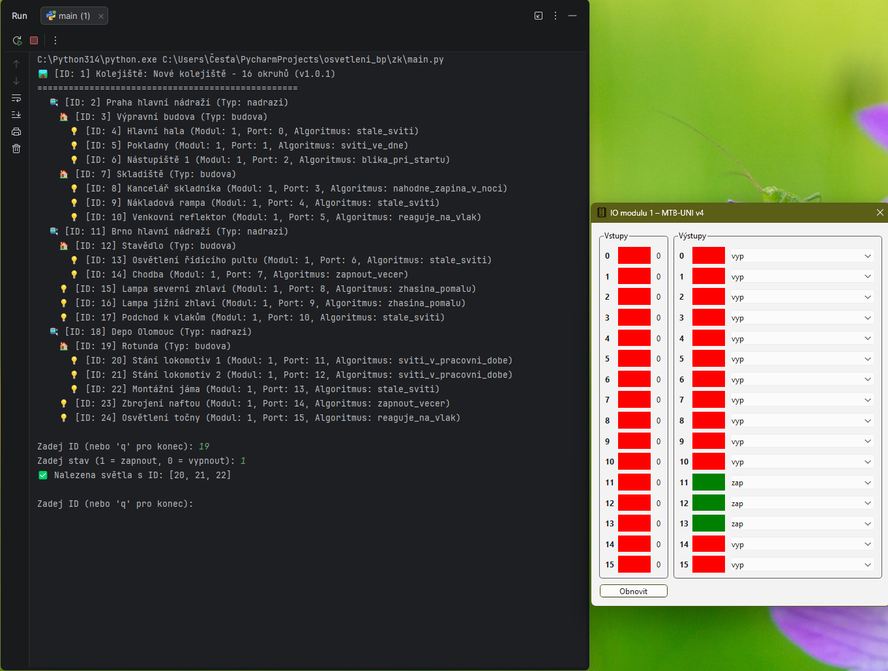
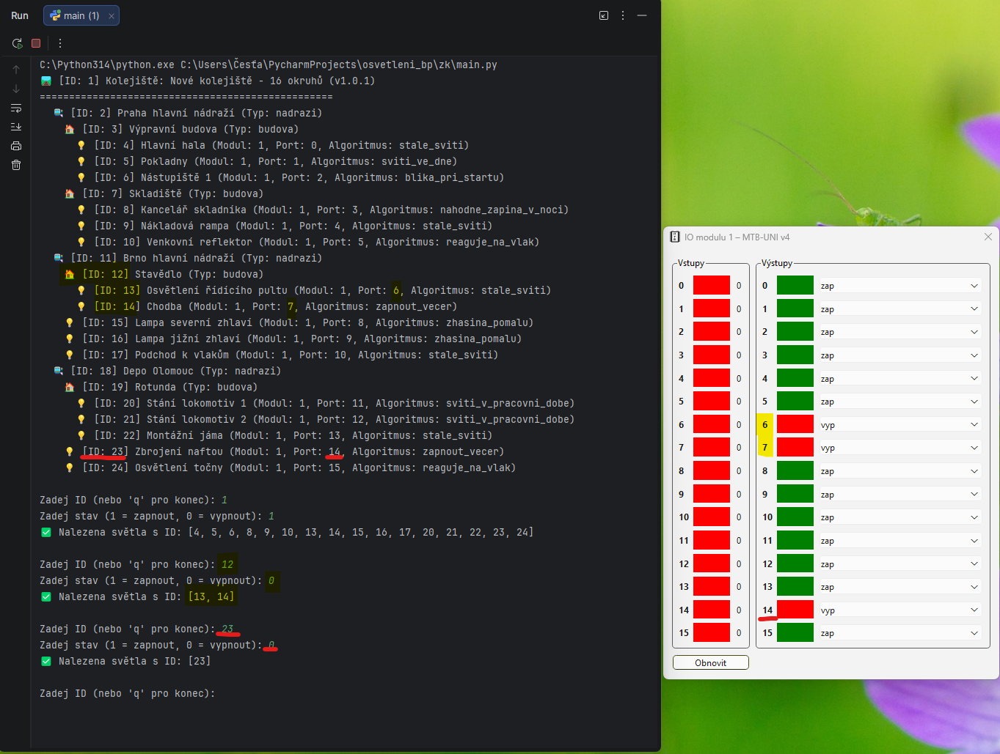

# Zapínání / vypínání

Stačí zadat ID a stav (1 = zapnout, 0 = vypnout) a nastaví daný stav pro všechny světelné okruhy které se nachízí v té skupině.

- první jsem zapnul celé kolejiště - **ID 1 stav 1**
- potom jsem vypnul budovu - sva světelné okruhy - **ID 12 a stav 0**
- vypnutí jednoho světla - **ID 23 a stav 0**

