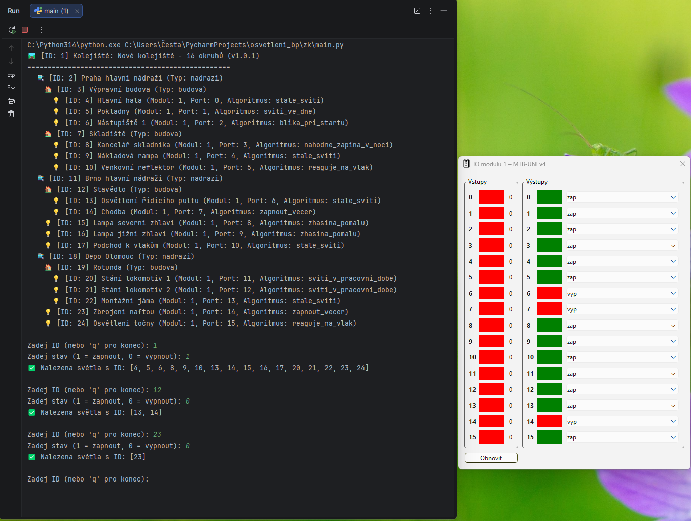

# Zapínání / vypínání

Stačí zadat ID a stav (1 = zapnout, 0 = vypnout) a nastaví daný stav pro všechny světelné okruhy které se nachízí v té skupině.

- první jsem zapnul celé kolejiště - **ID 1 stav 1**
- potom jsem vypnul budovu - sva světelné okruhy - **ID 12 a stav 0**
- vypnutí jednoho světla - **ID 23 a stav 0**

## Způsoby zapínání - vypínání
### A) automaticky

- dle algoritmu se v danou dobu změní stav - svítí od 19:30 do 5:45 - osvětlení kolejiště
- pseudonáhodné - někdy v rozmezí 18:00 - 20:00 se rozsvítí - okna domů

### B) Manuální

- přes webové rozhraní uživatel klikne na světelný okruh či skupinu
- ??? přes příkazový řádek - viz. screenshot ???

